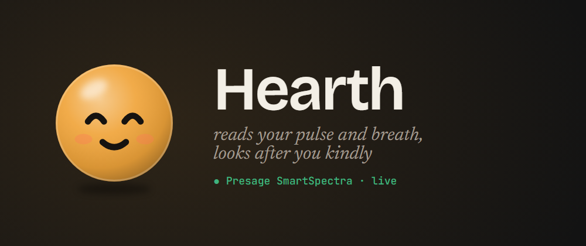
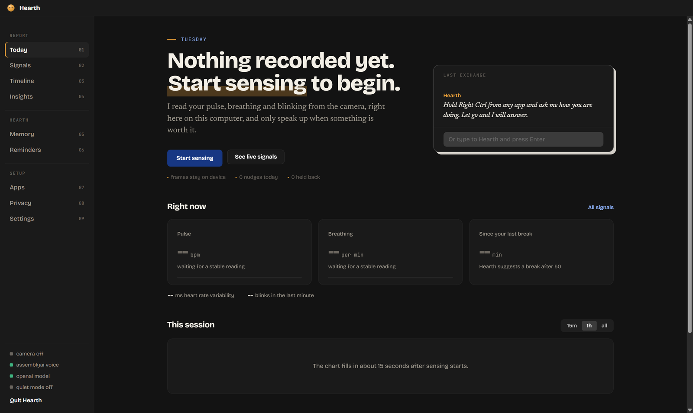
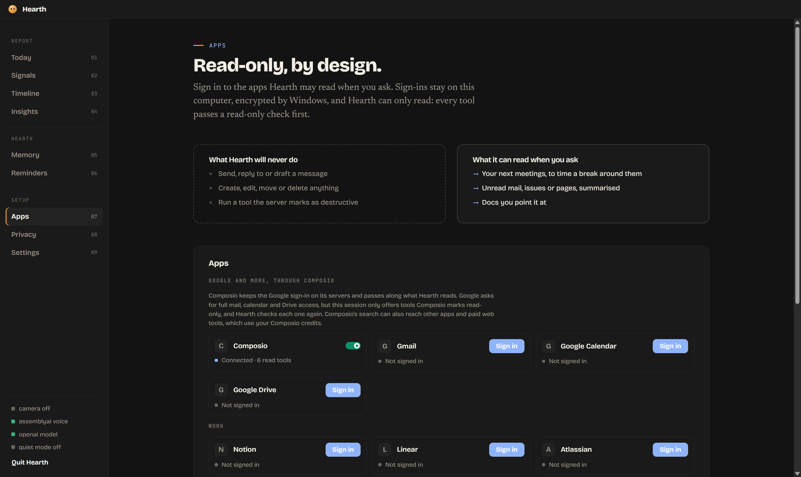
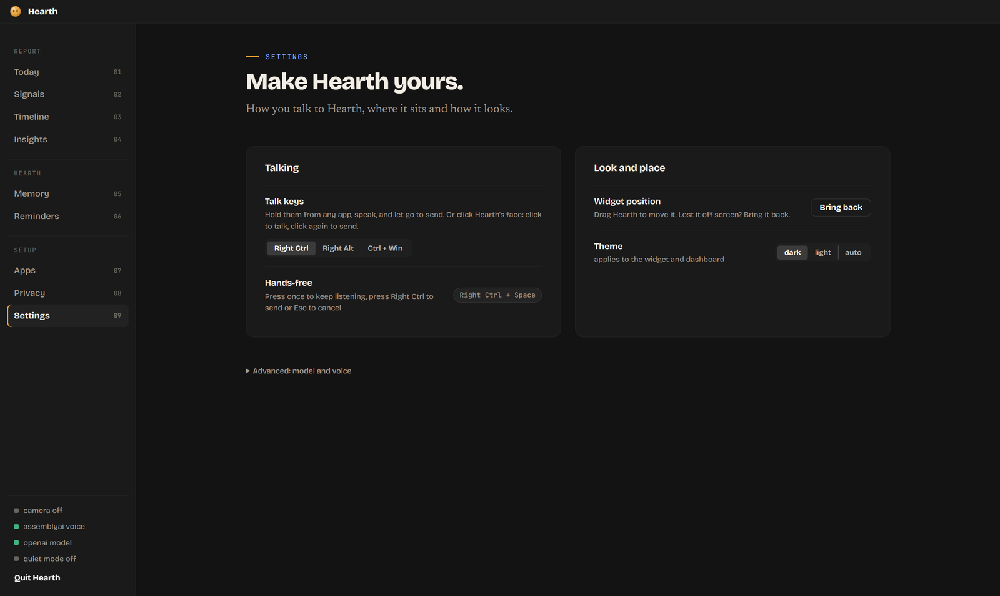
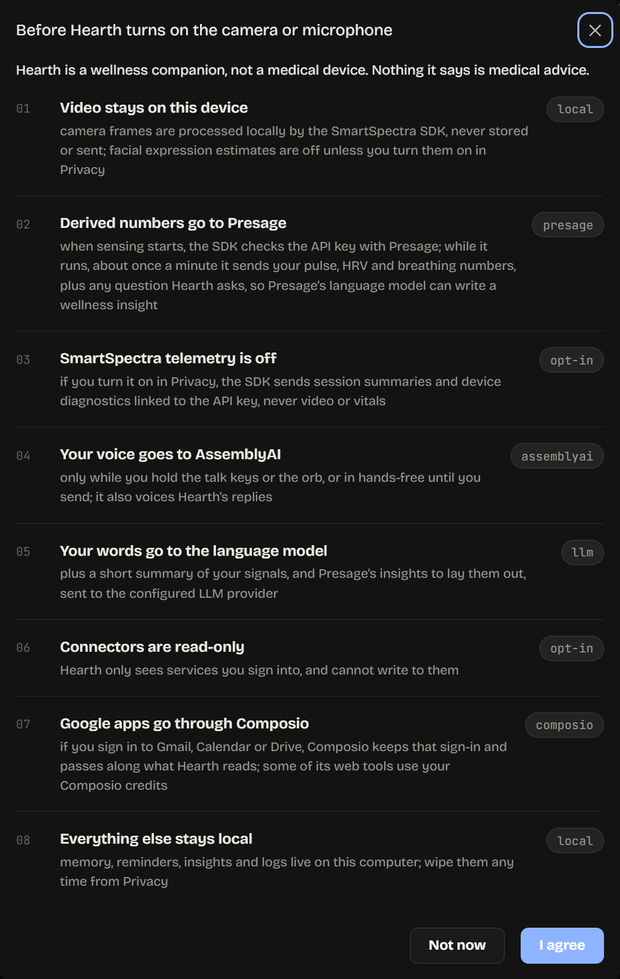

<p align="center">
  
</p>

Hearth is a small companion that lives on your desktop. It reads your pulse, breathing and blinks from the webcam with [Presage SmartSpectra](https://smartspectra.presagetech.com), talks with you by voice, and speaks up only when it matters: a break after long sitting, a slower breath when your pulse climbs, a reminder you asked for.

Built for the DEV.to Presage SmartSpectra challenge. A wellness companion, not a medical device.



## What it does

- **Reads live signals, on your computer.** Pulse, breathing, HRV and blinks come from the SmartSpectra SDK, and you choose which ones it reads. Camera frames never leave the device.
- **Talks by voice.** Hold Right Ctrl (Right Option on a Mac), ask, let go. Hearth answers out loud.
- **Knows when to stay quiet.** Breaks, breathing nudges and reminders (once, or repeating up to 10 times), with a warm-up, cooldowns and an hourly limit.
- **Checks in for you.** Say "keep an eye on my eye strain every 10 minutes". Hearth re-reads the signal and only speaks when something is off.
- **Reads your apps, never writes.** Calendar, Gmail, Notion, Linear and more, through read-only connectors.
- **Asks first.** Nothing turns on the camera or microphone until you agree.

## Quick start

You need Node 22 and a webcam. Hearth is built and tested on Windows 10 and 11. macOS on Apple Silicon and Linux (Ubuntu 22.04 or newer) are experimental: CI builds and starts them on every push, but they have not been tried with a camera yet. See [platform notes](docs/setup.md#macos-and-linux).

```bash
git clone https://github.com/md-abid-hussain/hearth.git
cd hearth
npm install
npm run dev
```

Before `npm run dev`, copy `.env.example` to `.env` and add three keys: `SMARTSPECTRA_API_KEY` from [Presage](https://physiology.presagetech.com), `ASSEMBLYAI_API_KEY` and `OPENAI_API_KEY`. Hearth also starts without them and shows what is missing.

Then click **Start sensing**, hold **Right Ctrl** (**Right Option** on a Mac) and ask "how am I doing?"

## Screenshots

| Read-only apps | Settings |
| --- | --- |
|  |  |

<p align="center">
  <br>
  <em>The consent screen, shown before the camera or microphone can start.</em>
</p>

## Learn more

- [Setup](docs/setup.md): every key, the commands, the talk keys
- [How it works](docs/how-it-works.md): SmartSpectra and Presage Insights in the code, when Hearth speaks, the architecture
- [Apps and connectors](docs/connectors.md): MCP servers, Composio and the read-only gate
- [Privacy](docs/privacy.md): what stays on your computer and what goes where

## License

No license file yet, so all rights are reserved by the author.
