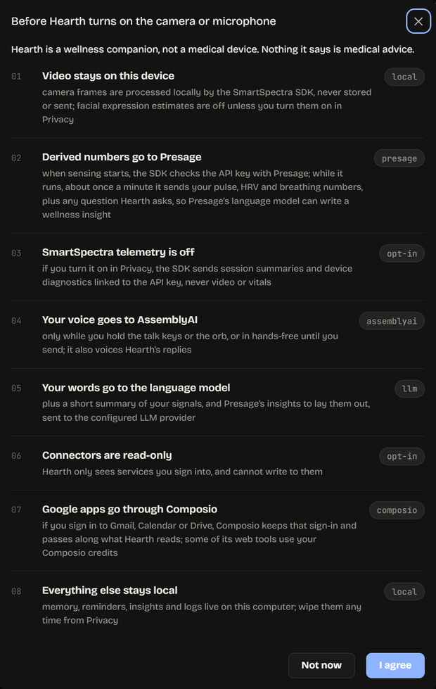

# Privacy and consent

[Back to the README](../README.md)

Hearth shows a consent screen the first time you open it. Until you choose **I agree**, sensing, talking and typing all stay off, and the main process refuses camera and microphone access.

The consent check runs in all three of Hearth's parts: the dashboard, the widget and the main process. To see the screen again or withdraw consent, use **Privacy > Review consent**.

## Where your data goes

- **Video stays on this computer.** The SmartSpectra SDK processes camera frames locally. Frames are never stored or sent.
- **Derived numbers go to Presage.** While sensing runs, the SDK sends your pulse, HRV and breathing values to Presage about once a minute, so Presage's model can write a wellness insight. Any question you ask about your vitals goes along too. Video and images of your face are never sent.
- **Facial expressions are off by default.** If you turn them on, the SDK estimates them on this computer, and they are never sent to the language model.
- **Your voice goes to AssemblyAI**, only while you hold the talk key or are in hands-free mode. AssemblyAI also voices Hearth's replies.
- **Your words go to the language model.** It receives what you say or type, plus a short summary of your signals, memory and reminders.
- **Apps are read-only.** Hearth sees only the services you sign into. If you sign in to Google apps, Composio holds that sign-in and relays what Hearth reads.
- **Everything else stays local.** Settings, memory, reminders, insights and the log are kept in Hearth's data folder: `%APPDATA%\hearth\hearth-data` on Windows, `~/Library/Application Support/hearth/hearth-data` on macOS, `~/.config/hearth/hearth-data` on Linux. Keys and tokens are kept there too, encrypted.
- **Delete it any time.** **Privacy > Delete all local data** removes that folder and signs you out of every app.
- **SmartSpectra telemetry is off by default.** If you turn it on, the SDK sends session summaries and device diagnostics linked to the API key. They never include video or vital signs.

## Sources

- [SmartSpectra docs index](https://smartspectra.presagetech.com/llms.txt): every metric is computed on the device. The backend is contacted only to check the API key.
- [LLM Insights](https://smartspectra.presagetech.com/docs/llm-insights): only the derived numbers and the prompt go to Presage, never video or images of your face.
- [Telemetry and privacy](https://smartspectra.presagetech.com/docs/telemetry-and-privacy): telemetry carries no video frames or vital signs.

Presage's general [privacy policy](https://api.physiology.presagetech.com/privacypolicy) is broader than these docs. It describes collecting biometric data from use of its SDK for research. Read it before you register for a key.

## Not medical advice

Hearth's signals are wellness estimates from a webcam, not medical readings. Hearth does not diagnose or treat anything. If you are worried about your health, talk to a professional.
